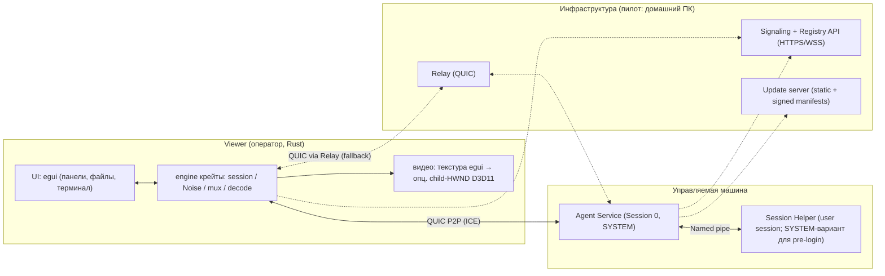
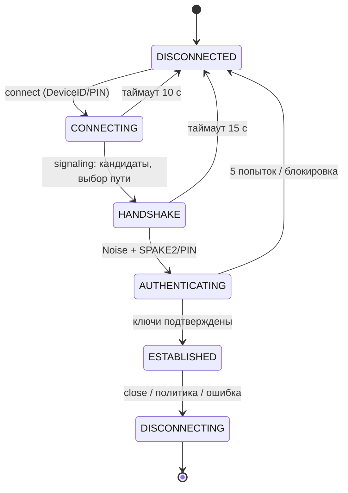

<!-- Прогон промта ARCHITECTURE_PROMPT_v2.md · Документ v1.1 · 2026-10-01 · AutoCoder -->
<!-- v1.1: решения владельца (2026-10-01): 1) ID машины — 6 цифр + auto-allow (только для доверенных операторов); 2) SAS — в MVP; 3) запись сессий — не в v1; 4) юрлица нет — подпись отложена, хостинг на домашнем ПК; 5) стек — всё на Rust (UI: egui/iced); 6) без платных лицензий. -->

# Проектный документ v1.1 — Система удалённого администрирования Windows («Rat Next»)

> Источник задачи: `ARCHITECTURE_PROMPT_v2.md` (этот же каталог). Статус: **v1.1 — решения владельца зафиксированы** (см. §7.3 и changelog в конце); остаточные открытые пункты — минимальны.
> Legacy-контекст: аудит Python-реализации (ratPy/POSonline) — см. §2 промта; все подтверждённые дефекты учтены.

## 0. Резюме

1. **Язык/стек (v1.1): всё на Rust** — агент, служба, session helper, relay, signaling и вьюер. UI вьюера — **egui/eframe** (MIT/Apache, бесплатно), кандидат-альтернатива — iced (MIT); выбор фиксируется недельным спайком в P0. Межъязыкового interop нет.
2. **Транспорт:** QUIC (quinn + rustls); P2P через ICE (str0m, fallback libdatachannel); relay-fallback — собственный стриминговый relay. Signaling — HTTPS/WSS (управляющий канал, не data-path).
3. **Крипто:** E2E Noise_XX поверх любого пути (релей не видит payload); первый коннект — SPAKE2 по PIN; идентичности — Ed25519 + TOFU-пиннинг; на relay — device-сертификаты (mTLS). **ID устройства — 6-цифровой псевдоним** (как в legacy; безопасность не зависит от него — см. §3.4); **auto-allow — только для доверенных операторов из ACL** (первый коннект подтверждается и запоминается).
4. **Видео:** захват — DXGI Desktop Duplication; кодек — аппаратный H.264 (NVENC/AMF/QSV, ultra-low-latency, intra-refresh, без B-кадров) + tile-JPEG delta как фолбэк для машин без HW-энкодера; декод — FFmpeg (LGPL, dynamic). Цель ≤50 мс P95 в LAN — с бюджетом по стадиям и методикой замера (§3.5).
5. **Обновления/развёртывание:** подписанные манифесты, rings, откат. **Code signing отложен** — юрлица пока нет (§2.7): для внутреннего пилота сборки без подписи; сертификат — к моменту внешнего распространения.
6. **Объём:** 9 фаз, ~20–33 недели (1 сильный разработчик; меньше при команде). P9 (подпись/AV/распространение) — вне критического пути пилота и зависит от появления юрлица.
7. **Non-goals v1:** аудио, мобильные и кроссплатформенные клиенты, VPN, печать, web-клиент, запись сессий, продвинутое управление парком.

---

## 1. Язык и стек

### 1.1 Сравнение кандидатов (обоснование выбора v1)

| Критерий | Rust | C++23 | C# (.NET LTS) | Go |
|---|---|---|---|---|
| Win32/COM interop | windows-rs зрелый; FFI к вендорным SDK | нативный, лучший | CsWin32/P-Invoke, Vortice; отлично | cgo слабый, GPU/COM плохо |
| Real-time / zero-overhead | ●●● | ●●● | ●●○ (GC, куча — управляемо пулами) | ●○○ (GC в hot path) |
| Memory safety | ●●● | ●○○ (ручной контроль) | ●●● (managed), ○○ в interop | ●●● |
| Async/сеть | tokio/quinn/rustls — отлично | asio/libuv — ок, но много ручного | отлично (но QUIC — сторонние) | отлично |
| Crypto/кодек-экосистема | strong (snow, dalek, ring); GPU — через FFI | эталон (FFmpeg, SDK) | ок (MF, libsodium bindings) | слабо |
| Сборка/подпись/CI | cargo + signtool | CMake/MSVC | MSBuild/dotnet | go build |
| Долгосрочная поддержка | ●●● | ●●○ (сложность) | ●●● | ●●○ (ниша) |

### 1.2 Вердикт (v1.1)

**Решение: всё на Rust.** Команда сильнее в Rust; двухъязычный split (v1) добавлял межъязыковую границу без C#-ресурса на ней — лишний риск и трение. Итог: один тулчейн (cargo), один стиль, ноль FFI внутри продукта (внешние SDK — только как C-библиотеки: FFmpeg/вендорные энкодеры).

Состав:
- **Крейты-ядро:** protocol / transport / crypto / mux / codec / capture / input / fs / service-utils.
- **Бинарники:** `agent` (служба), `agent-helper` (user-session/pre-login), `relay`, `signaling`, `viewer`.
- **UI вьюера (Rust):** **egui/eframe (MIT/Apache)** — базовый вариант; **iced (MIT)** — альтернатива; **Slint** — только через GPLv3/коммерческую лицензию, не подходит под «без платных лицензий» (не берём). Выбор — спайк в P0 (~неделя).
- **Видео-поверхность:** MVP — кадр как текстура egui (+2–4 мс); оптимизация — child-HWND с D3D11 flip-моделью (прямой своп) внутри окна egui.
- **Терминал:** VT-парсер (`vte` / `alacritty_terminal`) + собственный рендер сетки в UI.
- **Резерв (в decision log):** если Rust-UI окажется узким местом — вернуться к варианту «C# WPF UI поверх Rust-ядра» (ядро остаётся крейтами, граница C ABI добавляется позже).

**Почему не C++ (для ядра):** тот же класс производительности, что Rust, но memory-safety в сетевом агенте — критична; скорость разработки и поддержка хуже. FFmpeg/вендорные SDK всё равно цепляются как C-библиотеки.
**Почему не Go:** нет нативной ветки для DXGI/D3D/COM, нет зрелого UI, GC-паузы в видео-петле, и бинарники Go — частый источник AV false positives (прямой конфликт с §4.6 промта).
**Почему не C#-центричный путь:** ровно тот же аргумент, что в v1 против pure-C# — горячий путь и interop с вендорными энкодерами лучше в Rust; и у команды нет C#-фокуса.

### 1.3 Библиотеки по подсистемам (с лицензиями)

| Подсистема | Выбор | Лицензия |
|---|---|---|
| Capture (DXGI/D3D11) | windows-rs (crate `windows`) | MIT/Apache-2.0 |
| Encode HW | NVENC (nv-codec-headers, FFI), AMF (FFI), QSV/oneVPL | BSD-3 / MIT / MIT (SDK бесплатны) |
| Encode SW fallback | tile-JPEG (zune-jpeg) — единственный в v1 | MIT |
| Decode | FFmpeg (libavcodec, dynamic DLL), d3d11va | LGPL-2.1+ (dynamic → совместимо; нотисы обязательны) |
| Transport | tokio, quinn, rustls | MIT / MIT-Apache / Apache-ISC |
| ICE/STUN | str0m (primary), libdatachannel (fallback) | MIT-Apache / MPL-2.0 |
| Crypto | snow (Noise), ed25519-dalek, x25519-dalek, spake2, hkdf, chacha20poly1305 | Apache/MIT, BSD-3, MIT, MIT |
| Схемы | prost (protobuf), protoc | Apache-2.0, BSD-3 |
| Service | windows-service crate | MIT/Apache |
| UI вьюера | egui/eframe (или iced), egui_extras | MIT/Apache |
| Терминал (VT) | vte / alacritty_terminal | Apache/MIT |
| Logging/метрики | tracing + ETW (опц.) | MIT |
| Инсталлятор | WiX v4 (MSI) | MS-RL (OSI, для MSI-сборок ок) |
| Подпись | EV / Azure Trusted Signing — **отложено до юрлица** | сервис/железо |

---

## 2. Инструменты и процессы

- **IDE:** RustRover / JetBrains или VS Code + rust-analyzer.
- **Сборка:** Cargo workspace (единый репо: agent, service, relay, signaling, viewer, общие крейты); `rust-toolchain.toml` фиксирует версию.
- **Отладка/профайлинг:** WinDbg, WPR/WPA (ETW), Application Verifier; Tracy, VTune, GPUView (видео-пайплайн).
- **CI/CD (GitHub Actions, windows-runner):** `fmt` → `clippy -D warnings` → tests → `cargo-deny`/`cargo-audit` → SBOM (CycloneDX) → build → (sign — когда появится подпись) → WiX MSI → release-артефакты с checksum + подписанным манифестом. Каналы: `stable`/`beta`/`canary`.
- **Инсталлятор:** WiX v4 → MSI (нужен для GPO/Intune, upgrade/uninstall, silent install: `msiexec /qn RELAY=... GROUP=...`). Для внутреннего пилота допустима установка скриптом.
- **Подпись — отложена (v1.1).** Сертификаты выдаются организации — юрлица сейчас нет. План: внутренний пилот — сборки без подписи в своём/управляемом контуре (для своих машин допустимы локальные AV-исключения — только на время пилота); перед внешним распространением — юрлицо (своё или через организацию заказчика) → EV/Azure Trusted Signing + SHA-256 + RFC 3161. SHA-1 не используем.
- **Инфраструктура пилота (домашний ПК):** relay + signaling + хранилище артефактов на домашней машине. Требования: постоянное включение, автозапуск и мониторинг процесса; доступ из интернета — «белый» IP + проброс порта, либо DDNS, либо туннель (если провайдер за NAT — понадобится туннель или минимальный VPS; проверяем на P0); upload-канал важен для relay-fallback. На relay нет чувствительных данных, кроме метаданных (время/IP/объём) и публичных артефактов обновлений — E2E это позволяет. При росте парка — переезд на VPS без смены протокола (адреса в конфиге).
- **Enterprise (к внешнему распространению):** MSI/GPO/Intune, silent-параметры, ADMX (опц.), отсутствие входящих портов у агента.

---

## 3. Архитектура

### 3.1 Компоненты



| Компонент | Ответственность | Технология |
|---|---|---|
| Agent Service | сессии, сеть, crypto, файлы/реестр, обновления, аудит | Rust, Windows Service (SCM), SYSTEM |
| Session Helper | захват, ввод, clipboard, ConPTY, индикация | Rust, в user-session (или SYSTEM для pre-login задач) |
| Viewer (engine + UI) | коннект, Noise, mux, декод, рендер, интерфейс | Rust (egui/eframe; кандидат iced) |
| Relay | pairing по session-id, форвард непрозрачных байтов, rate-limit | Rust (quinn) |
| Signaling/Registry | устройства, группы, ACL, presence, сессионные офферы | Rust (HTTP/WSS, Postgres; артефакты — S3-совместимо/локально) |
| Update server | подписанные манифесты, rings | статика + CDN/локально |

### 3.2 Процессы, сессии, IPC

- Служба ставится инсталлятором (LocalSystem). **Никаких входящих портов** — только исходящие соединения.
- Хелпер запускается: (а) в интерактивной сессии через `WTSQueryUserToken` + `CreateProcessAsUserW`; (б) для pre-login — процесс от SYSTEM-токена в консольной сессии (`SetTokenInformation(TokenSessionId)`, требует `SeTcbPrivilege`).
- IPC: **named pipe** (message-framing по schema, max размеры, таймауты); ACL: SYSTEM + service SID + SID пользовательской сессии; валидация клиента по PID + строгая проверка схемы и границ.
- Устойчивость: пере-инициализация DXGI при `DXGI_ERROR_ACCESS_LOST` / смене режима; пересоздание хелпера при смене сессии/логгоне; watchdog службы; потеря GPU — деградация в GDI/JPEG-фолбэк.
- Мультисессии: поддерживаем консольную сессию + активные RDP-сессии на выбор оператора (`WTSEnumerateSessionsW`); fast user switching обрабатывается перезапуском хелпера.

### 3.3 Каналы и приоритеты

| Канал | Приоритет | Политика при перегрузке |
|---|---|---|
| Control/RPC | P0 | reliable, никаких дропов |
| Input (мышь/клава) | P0 | reliable, минимальная задержка (коалессинг движений мыши) |
| Cursor | P1 | droppable (последний выигрывает) |
| Video | P1 | **droppable**: пропуск устаревших кадров, keyframe при перестройке |
| Files | P2 | reliable, flow-control (кредиты) |
| Terminal | P2 | reliable |
| Clipboard | P3 | reliable, дебаунс |
| Audio (future) | P3 | droppable |

Мультиплексирование: внутри E2E-сессии — собственный mux (длина+заголовок кадра, channel id, flags, seq, ts) поверх одного надёжного упорядоченного логического канала (QUIC-поток / relay-поток). Опция на будущее: video через QUIC datagrams.

### 3.4 Идентификация, крипто-слои, доступ

| Плечо | Протокол | Аутентификация |
|---|---|---|
| Viewer ↔ Relay (hop) | QUIC + TLS 1.3 | сертификат сервера; клиент — **device-сертификат** (mTLS), выданный при enrollment |
| Agent ↔ Relay (hop) | QUIC + TLS 1.3 | то же (device-сертификат агента) |
| Viewer ↔ Agent (E2E) | **Noise_XX** (snow) поверх логического канала (P2P или через relay; relay форвардит непрозрачные байты) | Ed25519-идентичности устройств + пиннинг; первый коннект — **SPAKE2** (PIN) |

- **ID устройства — 6-цифровой псевдоним (v1.1).** Удобно диктовать (как в legacy). Безопасность от него не зависит: доступ решает криптоаутентификация. Защита от слабой адресации: сервер гарантирует **уникальность** ID (выдача при enrollment, карантин при переиспользовании), жёсткие **rate-limit'ы** на поиск ID и попытки подключения (на устройство/на IP/глобально), журналирование. При необходимости формат можно расширить позже без смены UX (алias → внутренний 128-битный идентификатор).
- **auto-allow (v1.1):** разрешено **только операторам из списка доверенных устройства**. Первый коннект — подтверждение на машине (диалог «разрешить этому оператору» / политика админа), ключ оператора пиннится, дальше подключение автоматическое. Всё авто-подключения — в журнал; отзыв и «заблокировать всё» — в один клик. По умолчанию новых/неизвестных операторов авто-подключение не пускает.
- Иерархия ключей: долговременные Ed25519 (агент/вьюер) → enrollment (агент: код/админ-преавторизация; CSR) → краткоживущий device-сертификат → сессионный Noise с эфемерными X25519 (forward secrecy).
- PIN: генерируется агентом, показывается на экране управляемой машины (и/или задаётся политикой), TTL 60 с, лимиты: 5 попыток/сессия, 10/мин на агент, глобальный троттлинг; SPAKE2 исключает оффлайн-перебор и MITM на relay.
- Хранение секретов: Windows DPAPI (machine scope) для ключей агента; опция CNG/TPM; крипто — только из проверенных крейтов (§1.3).

Схема состояний (таймауты — дефолты конфига):



### 3.5 Медиа-пайплайн

- Захват: `IDXGIOutput1::DuplicateOutput` → `AcquireNextFrame` (dirty rects, move rects); курсор — отдельно (shape+pos, наложение на клиенте); мультимониторы — выбор источника.
- Энкод: NVENC/AMF/QSV, профиль ultra-low-latency: CBR/VBR с rate-control от адаптива, **без B-кадров**, `frameIntervalP=1`, **intra-refresh**, IDR по требованию (потеря/подключение/скачок качества). Фолбэк для машин без HW-энкодера: tile-JPEG delta 64×64 (xxh64) — единственный SW-путь в v1.
- Адаптив: раз в секунду — метрики (RTT, send-queue, skip rate, loss); гистерезис: сбрасываем качество быстро, поднимаем медленно; при изменении масштаба/битрейта — принудительный keyframe.
- UI-путь кадра: decode → текстура egui (MVP) → опционально child-HWND D3D11 (снижение задержки).
- Latency-бюджет (1080p30, LAN; P95 ≤50 мс):

| Стадия | Бюджет |
|---|---|
| Acquire + GPU copy | 1–4 мс |
| Encode (HW) | 3–7 мс |
| Пакетизация + отправка | 1–2 мс |
| Сеть (LAN) | 1–10 мс |
| Decode (HW) | 2–5 мс |
| Present (без vsync) | 1–8 мс |

- Измерение: in-band таймстемпы (capture→packet→decode→present) + периодическая валидация «input-to-photon» высокоскоростной камерой. Без vsync по умолчанию (опция сглаживания).

### 3.6 Протокол (sketch)

- Control/события — **Protobuf** (prost), версионированная схема, capability-negotiation в Hello; media/файлы — сырые бинарные кадры (не protobuf).
- Envelope (control): `{ ver, type, request_id, payload }`; типизация по сообщениям (Hello/Offer/Answer/Candidates/Auth/FsList/FsRead/FsWrite/Clip/...). Пример:

```proto
syntax = "proto3";
message Envelope { uint32 ver = 1; uint64 request_id = 2; oneof body {
  Hello hello = 10; AuthProof auth = 11; InputEvent input = 20;
  ClipboardEvent clip = 30; FsRequest fs = 40; }
}
```

- Media-кадр: `{ channel=video, codec, frame_id, ts, flags, len, NAL chunks }`; дроп устаревших кадров до отправки (по send-queue).
- Ограничения: max frame 16 МБ, max message 1 МБ (control); fuzz-цели: парсер envelope, mux-кадры, fs-протокол, рукопожатие.

### 3.7 Файлы

Chunk = 1 МБ, per-chunk checksum xxh3-128 + итоговый SHA-256; resume по битмапе чанков; прогресс/отмена. Безопасность: канонизация путей, запрет symlink/junction-выхода за корень по умолчанию, запрет `..`, отдельные правила для системных каталогов.

### 3.8 Автообновление

Манифест: версия, канал, SHA-256 артефактов, подпись Ed25519 (offline root, pubkey вшит в бинарники). Поток: check (rings: canary→beta→stable) → download → verify → stage → swap через updater-процесс (MoveFileEx PENDING / stop-start службы) → health-check → при N неудачных стартов — **rollback** к N-1 (предыдущий бинарник сохраняется). Запрет downgrade ниже min-version.

### 3.9 Серверная часть (пилот)

Relay: один бинарник (Rust), pairing по session-id (128-bit), лимиты на join, без хранения payload. Signaling/Registry: HTTPS + WSS, Postgres; устройства/группы/ACL; сбор аудита сессий. Хранилище артефактов обновлений — локально/S3-совместимо. Пилот — домашний ПК (требования см. §2); далее — VPS без смены протокола.

---

## 4. Roadmap

| Фаза | Цель / deliverables | Exit criteria | Оценка |
|---|---|---|---|
| P0 | Scaffold репо, CI, schema v0, **spikes**: DXGI+encode, quinn transport, str0m ICE, NVENC hello-world, **UI-спайк (egui vs iced)**; threat-model v0 | CI зелёный; spikes закрыты отчётами; UI-кит выбран | 1–2 нед |
| P1 | Локальный видео-луп: capture→encode→present (без сети) | 1080p30 локально, бюджет стадий измерен | 2–4 нед |
| P2 | Протокол v1 + mux + loopback (агент↔вьер на одной машине); fuzz v0 | Сессия работает локально; fuzz-харнесс запущен | 2–4 нед |
| P3 | Ввод (SendInput), курсор, мультимониторы | Играбельный UX в LAN | 1–2 нед |
| P4 | Транспорт: signaling + relay + P2P ICE + fallback; Noise + PIN/SPAKE2; state machine; rate-limits | Подключение «из интернета»; MITM-тест пройден; relay не читает payload (проверка) | 2–4 нед |
| P5 | Файлы (resume/checksums) + файловый менеджер UI; clipboard | 1 ГБ передаётся с докачкой; clipboard обе стороны | 2–3 нед |
| P6 | Терминал (ConPTY + VT-core), процессы, реестр | Интерактивный PowerShell, ANSI-цвета | 1–2 нед |
| P7 | Служба + session helper + SAS/pre-login; update-подсистема v1 | Установка (пилотная); удалённый Ctrl+Alt+Del работает; вход до логина (best effort, ограничения задокументированы); обновление с откатом | 2–3 нед |
| P8 | Hardening: fuzz-раунды, soak 24ч, AV-матрица, перф-тюнинг; внешний security review | Все критерии §9 промта; отчёты ревью закрыты | 2–3 нед |
| P9 | Распространение: MSI/GPO, сабмиты AV, пилот на POS-парке. **Подпись — вне критического пути пилота** (нужна для внешнего распространения; зависит от появления юрлица — внешний фактор) | Пилот ≥10 машин; при наличии юрлица — процесс подписи запущен | 2–6 нед (параллельно; может сдвигаться вправо) |

Итого ~20–33 недели (1 сильный разработчик; команда — меньше). Внешние лид-таймы: юрлицо/сертификат — недели-месяцы (к распространению); AV-репутация — недели (после подписи); для пилота без подписи допускаются локальные AV-исключения в своём контуре. Допущения: HW-энкодеры есть на большинстве целевых машин (иначе tile-фолбэк); Winlogon-захват реализуем на выбранных сборках Win10/11 (риск, тесты в P7).

Тест-стратегия: unit (схемы, mux, пути), integration (loopback, синтетические кадры), **fuzz с P2** (envelope/mux/fs/handshake), soak 24 ч, сетевые симуляции (потери 1–5%, RTT 50–200 мс), матрица: Win10 22H2 / Win11 22H2–24H2, GPU NV/AMD/Intel/без GPU, AV: Defender/ESET/Kaspersky/Dr.Web/Bitdefender, сценарии: locked/UAC/RDP/fast-switch.

---

## 5. Ключевые API (≥30)

**DXGI/D3D11:** `D3D11CreateDevice`, `IDXGIOutput1::DuplicateOutput`, `IDXGIOutputDuplication::AcquireNextFrame`, `ReleaseFrame`, `IDXGIResource::QueryInterface`, `IDXGISurface::Map`.
**Ввод:** `SendInput`, `GetCursorInfo`, `GetForegroundWindow`, `GetKeyboardLayout`, `MapVirtualKeyEx`, `PostMessageW(WM_INPUTLANGCHANGEREQUEST)`, `GetSystemMetrics`.
**SCM/служба:** `OpenSCManagerW`, `CreateServiceW`, `StartServiceW`, `ControlService`, `DeleteService`, `StartServiceCtrlDispatcherW`, `RegisterServiceCtrlHandlerExW`, `SetServiceStatus`.
**Сессии/secure desktop:** `WTSEnumerateSessionsW`, `WTSGetActiveConsoleSessionId`, `WTSQueryUserToken`, `WTSQuerySessionInformationW`, `CreateProcessAsUserW`, `DuplicateTokenEx`, `SetTokenInformation`, `OpenInputDesktop`, `SetThreadDesktop`, `SendSAS`.
**Мониторы:** `EnumDisplayMonitors`, `GetMonitorInfoW`, `EnumDisplayDevicesW`.
**Сеть:** `GetAdaptersAddresses`, `WSAIoctl(SIO_KEEPALIVE_VALS)`, `WSASocket`, `getaddrinfo` (плюс quinn/rustls уровнем выше).
**Clipboard:** `AddClipboardFormatListener`, `WM_CLIPBOARDUPDATE`, `OpenClipboard`, `GetClipboardData`, `SetClipboardData`, `EmptyClipboard`, `GetClipboardSequenceNumber`.
**Hardware ID:** `DeviceIoControl(IOCTL_STORAGE_QUERY_PROPERTY)`, `GetSystemFirmwareTable('RSMB')`, `GetComputerNameExW`, WMI-fallback.
**Named pipe:** `CreateNamedPipeW`, `ConnectNamedPipe`, `ImpersonateNamedPipeClient`, `CreateFileW(\\.\pipe\...)`.
**ConPTY:** `CreatePseudoConsole`, `ResizePseudoConsole`, `ClosePseudoConsole`, `InitializeProcThreadAttributeList`, `UpdateProcThreadAttribute`.
**Процессы/реестр:** `EnumProcesses`, `OpenProcess`, `QueryFullProcessImageNameW`, `GetProcessMemoryInfo`, `RegOpenKeyExW`, `RegEnumKeyExW`, `RegQueryValueExW`.
**Прочее:** `CreateMutexW` (single-instance), `SetProcessDpiAwarenessContext`, `ChangeWindowMessageFilterEx`.

---

## 6. Threat model (STRIDE)

| # | Угроза (граница) | Митигации | Остаточный риск |
|---|---|---|---|
| 1 | **Malicious relay** (Spoofing/Tampering/Info) | E2E Noise (relay = opaque pipe); SPAKE2 против MITM; пиннинг устройств | DoS (см. #4) |
| 2 | **Compromised viewer** (EoP) | scopes прав (видео/ввод/файлы/терминал/реестр по отдельности), per-agent ACL, аудит, отзыв ключей; терминал — отдельный scope | Высокий по природе: документируем, минимизируем |
| 3 | **Replay/порядок** (Spoofing) | свежие nonce/эфемерные ключи на сессию; Noise; ts-окна; привязка к device-ключам | — |
| 4 | **DoS signaling/handshake** | rate-limit (IP/устройство/сессия), соединение-капы, дешёвая отбраковка, блок-листы | Умеренный |
| 5 | **Supply chain** | фикс версий, cargo-deny/audit, SBOM, ревью крейтов, минимум зависимостей | Умеренный |
| 6 | **Update channel** (Tampering) | подписанные манифесты (offline root), staged rings, rollback, min-version | Низкий |
| 7 | **Local EoP на агенте** | строгая валидация IPC (schema+границы), ACL pipe, минимальные привилегии, path-validation, нет eval/exec по сети | Низкий-умеренный |
| 8 | **Spoofing/энумерация адресации** (6-цифр. ID) | ID — лишь псевдоним; доступ решают ключи; уникальность ID на сервере; rate-limit на поиск ID и подключения; журнал | Низкий при лимитах |
| 9 | **Clipboard-утечки** (Info) | дебаунс, политика синхронизации, ограничение типов (текст/CF_HDROP) | Умеренный (осознанный) |
| 10 | **Локальная утечка ключей** | DPAPI/TPM, минимальные права файлов | Низкий |
| 11 | **Auto-allow злоупотребление** | авто-подключение только для ACL-операторов; пиннинг при первом коннекте; аудит; отзыв; лимиты на новые устройства | Умеренный |

Границы доверия: (а) relay/интернет — недоверенные; видит только шифротекст+метаданные (ID, время, объём); (б) вьюер — доверенный, но компрометация учитывается; (в) ОС агента — защищаемся от внешних, не от админа локально.

---

## 7. Риски, допущения, решения

### 7.1 Риски
| Риск | P/I | Митигация |
|---|---|---|
| Winlogon/UAC-захват сложнее ожидаемого | С/В | ранние тесты (P7), SYSTEM-хелпер через активный input desktop; честные ограничения в документации |
| ICE за CGNAT/симметричным NAT | С/С | relay-fallback всегда; метрики доли P2P |
| Отсутствие HW-энкодера | С/С | tile-JPEG фолбэк (проверен в legacy) |
| Лицензии (H.264/FFmpeg) | Н/С | динамическая линковка LGPL, нотисы; HW-энкодеры без x264 |
| AV false positives без подписи | В/В | пилот — в своём контуре с локальными исключениями; к распространению — юрлицо+подпись+сабмиты |
| Rust-UI (egui) не дотянет по UX | С/С | спайк в P0; резерв — C# WPF UI поверх ядра |
| Домашний хостинг: аптайм/канал | С/С | P2P-приоритет (relay — только фолбэк), мониторинг, план VPS; данные на relay — только метаданные |
| Навыки команды | Н/С | стек заточен под Rust-сильную команду (v1.1) |

### 7.2 Допущения
- Целевые машины — Win10/11 x64; как минимум один аппаратный энкодер у большинства; интернет-доступ только исходящий.
- Пилот: свой/заказчика контур; хостинг — домашний ПК (белый IP или туннель); юрлица нет — подпись отложена.
- Команда Rust-ориентированная; релизный цикл — недели.

### 7.3 Зафиксированные решения владельца (2026-10-01)
1. **ID машины — 6 цифр + auto-allow** → реализовано как: короткий псевдоним + авто-подключение только для доверенных операторов (см. §3.4 и §6#8, #11).
2. **SAS (удалённый Ctrl+Alt+Del) — в MVP**; захват экрана входа/блокировки — best effort.
3. **Запись сессий — не в v1** (в non-goals; кандидат в v1.x).
4. **Юрлица нет; хостинг — домашний ПК** → подпись отложена (внутренний пилот без подписи); к распространению — решить вопрос юрлица; требования к хостингу — §2.
5. **Стек — всё на Rust** (команда сильнее в Rust); UI — egui/iced, выбор в P0.
6. **Без платных лицензий** — SW-энкод остаётся tile-JPEG; платные опции (x264 и т.п.) не используем.

Остаётся уточнить: (a) egui vs iced — по итогам спайка P0; (b) домен/DDNS/туннель для домашнего сервера — проверка на P0; (c) сроки и способ появления юрлица (влияет на P9); (d) нужен ли позже UDP-релей (TURN/coturn) — по метрикам P2P-доли.

### 7.4 Non-goals v1
Аудио, мобильные приложения, Linux/macOS-клиенты, VPN, печать, web-клиент, **запись сессий**, управление парком сверх базового (только аудит сессий).

---

## 8. Decision log

| Решение | Альтернативы | Почему |
|---|---|---|
| **Всё на Rust** (v1.1; UI: egui/iced) | split Rust+C# (v1), всё-C#, C++, Go | команда сильнее в Rust; нет C#-ресурса; один тулчейн, ноль межъязыковых швов |
| UI: egui/eframe (кандидат iced) | Slint, WPF, egui vs iced | бесплатные лицензии (MIT/Apache); Slint — GPL/коммерческая, не под бюджет; финальный выбор — спайк P0 |
| QUIC (quinn) для транспорта | свой mux поверх TLS/TCP | мультиплекс+миграция соединений из коробки; TLS1.3 внутри |
| ICE: str0m (fallback libdatachannel) | писать руками; libwebrtc | чистый Rust без C-зависимостей; fallback — зрелый C++ |
| Собственный relay (stream) | TURN/coturn; WebRTC SFU | pairing/ACL/аудит под нашу модель; TURN не даёт нужной семантики+E2E-прозрачности; coturn — опция позже |
| Noise_XX E2E поверх обоих путей | только TLS к relay; DTLS-SRTP | единая модель безопасности, relay не видит payload, простой path-switch |
| PIN через SPAKE2 | сравнение PIN; HMAC-челлендж | исключает перебор/MITM на relay при первом коннекте |
| **ID — 6-цифровой псевдоним + авто-подключение для ACL-операторов** (v1.1) | 9–12 base32; только ключи | решение владельца; компенсируем уникальностью ID, rate-limit'ами, пиннингом и аудитом |
| HW H.264 + tile-JPEG фолбэк | AV1/VP9; SW H.264 (x264) | совместимость и HW-поддержка; без платных лицензий; AV1 — позже |
| FFmpeg (dynamic) для декода | Media Foundation; свой | предсказуемость, HW-декод d3d11va; LGPL соблюдаем динамикой |
| Protobuf для control; raw binary для media/файлов | всё Protobuf; Cap'n Proto/FlatBuffers | prost зрелый; media не любит schema-оверхед |
| WiX (MSI) | Inno Setup | GPO/Intune, корпоративный стандарт |
| **Подпись — отложена до юрлица** (v1.1) | self-signed; не подписывать вообще | юрлица нет; для пилота ок в своём контуре; к распространению — обязательно |
| DPAPI machine-scope (опция TPM) | plaintext; CNG | стандарт для служб, минимум кода |
| **Запись сессий — не в v1** (v1.1) | делать сразу | нет требования; аудита действий достаточно |
| **Хостинг — домашний ПК (пилот)** (v1.1) | VPS сразу | нет инфраструктуры; при росте — VPS без смены протокола |

---

## Changelog v1 → v1.1 (2026-10-01)

- Стек: «Rust-ядро + C# WPF UI» → **«всё Rust»** (UI: egui/iced; спайк в P0). Удалены C#-разделы (IDE/сборка/либы).
- ID/доступ: добавлены 6-цифровой псевдоним + auto-allow для доверенных операторов (плюс меры против энумерации; threat model обеими строками #8/#11).
- SAS/pre-login: из «вопрос» → **в MVP** (P7, с best-effort оговорками).
- Запись сессий: → **non-goal v1**.
- Подпись: из «Phase 0» → **отложена до юрлица**; пилот без подписи (локальные исключения допустимы); P9 переписан.
- Хостинг: добавлен раздел «инфраструктура пилота на домашнем ПК» (§2, §3.9).
- Лицензии: зафиксирован запрет платных (SW-энкод = tile-JPEG; Slint не берём).
- §7.3: вопросы владельцу → «Зафиксированные решения» + остаточные уточнения.

*Конец документа.*
