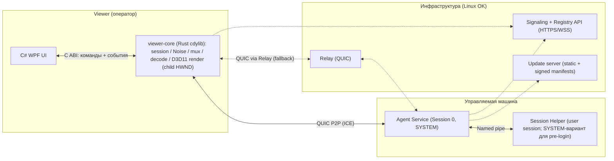
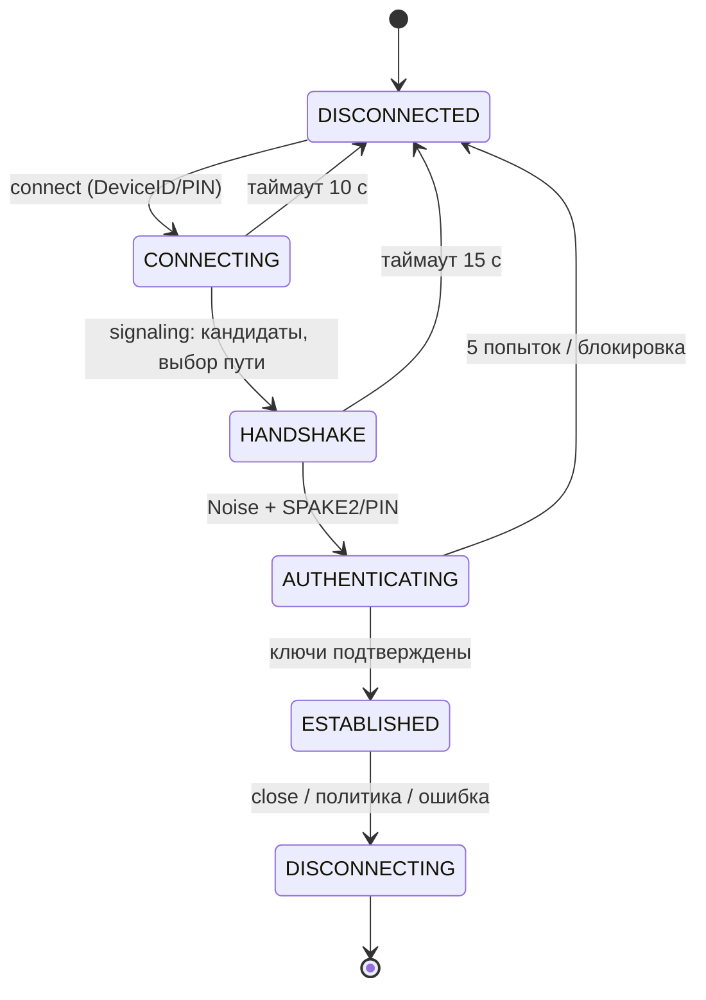

<!-- Прогон промта ARCHITECTURE_PROMPT_v2.md · Документ v1 (draft for review) · 2026-10-01 · AutoCoder -->

# Проектный документ v1 — Система удалённого администрирования Windows («Rat Next»)

> Источник задачи: `ARCHITECTURE_PROMPT_v2.md` (этот же каталог). Статус: **черновик на ревью** — открытые вопросы в §7.3.
> Legacy-контекст: аудит Python-реализации (ratPy/POSonline) — см. §2 промта; все подтверждённые дефекты учтены.

## 0. Резюме

1. **Язык/стек:** ядро (агент, служба, relay, общие крейты, вьюер-ядро) — **Rust**; UI вьюера — **C# (WPF, .NET LTS)**. Граница между ними узкая: Rust cdylib с C ABI + отдельный HWND с D3D11 swapchain для видео.
2. **Транспорт:** **QUIC (quinn + rustls)**; P2P через **ICE** (основной движок — str0m, fallback libdatachannel); relay-fallback — собственный стриминговый relay. Signaling — HTTPS/WSS (только управляющий канал, не data-path).
3. **Крипто:** E2E **Noise_XX** поверх любого пути (релей не видит payload); первый коннект — **SPAKE2 по PIN**; идентичности — Ed25519 + TOFU-пиннинг; на relay — device-сертификаты (mTLS) для ACL и отзыва.
4. **Видео:** захват — **DXGI Desktop Duplication**; кодек — **аппаратный H.264** (NVENC/AMF/QSV, ultra-low-latency, intra-refresh, без B-кадров) + **tile-JPEG delta** как фолбэк; декод — FFmpeg (LGPL, dynamic) c d3d11va. Цель ≤50 мс P95 в LAN — с бюджетом по стадиям и методикой замера (§3.5).
5. **Обновления/развёртывание:** подписанные манифесты, rings, откат; MSI (WiX v4) + GPO/Intune; подпись **SHA-256** (EV / Azure Trusted Signing), без SHA-1.
6. **Объём:** 9 фаз, ~**20–33 недели** разработки (1 сильный разработчик; меньше при команде) + внешние лид-таймы (сертификат, AV-whitelisting).
7. **Non-goals v1:** аудио, мобильные и кроссплатформенные клиенты, VPN, печать, web-клиент, продвинутое управление парком.

---

## 1. Язык и стек

### 1.1 Сравнение кандидатов

| Критерий | Rust | C++23 | C# (.NET LTS) | Go |
|---|---|---|---|---|
| Win32/COM interop | windows-rs зрелый; FFI к вендорным SDK | нативный, лучший | CsWin32/P-Invoke, Vortice; отлично | cgo слабый, GPU/COM плохо |
| Real-time / zero-overhead | ●●● | ●●● | ●●○ (GC, куча — управляемо пулами) | ●○○ (GC в hot path) |
| Memory safety | ●●● | ●○○ (ручной контроль) | ●●● (managed), ○○ в interop | ●●● |
| Async/сеть | tokio/quinn/rustls — отлично | asio/libuv — ок, но много ручного | отлично (но QUIC — сторонние) | отлично |
| Crypto/кодек-экосистема | strong (snow, dalek, ring); GPU — через FFI | эталон (FFmpeg, SDK) | ок (MF, libsodium bindings) | слабо |
| Сборка/подпись/CI | cargo + signtool | CMake/MSVC | MSBuild/dotnet | go build |
| Долгосрочная поддержка | ●●● | ●●○ (сложность) | ●●● | ●●○ (ниша) |

### 1.2 Вердикт и границы

**Основная рекомендация: Rust-ядро + C# WPF UI (split).**
- Rust: agent, service, session helper, relay, общие крейты (protocol/transport/crypto/mux/codec), **viewer-core как cdylib** (C ABI): сеть, Noise, декод, рендер в child-HWND (D3D11 flip swapchain).
- C#: только UI вьюера (WPF: адресная книга, окно сессии, файловый менеджер, терминал, настройки). Общение с viewer-core — C ABI команды/события (без protobuf на этой границе).
- Альтернативы (в decision log §8): «всё Rust» (UI Slint — если команда чисто-Rust), «всё C#» (быстрее старт, слабее hot-path/низкий уровень). Ключ: команда должна подтвердить компетенции (§7.3 Q5).

**Почему не C++ (для ядра):** тот же класс производительности, что Rust, но memory-safety в сетевом агенте — критична; скорость разработки и поддержка хуже. FFmpeg/вендорные SDK всё равно цепляются как C-библиотеки.
**Почему не Go:** нет нативной ветки для DXGI/D3D/COM, нет зрелого UI, GC-паузы в видео-петле, и бинарники Go — частый источник AV false positives (прямой конфликт с §4.6 промта).
**Почему не pure C#:** горячий путь и interop с вендорными энкодерами лучше в Rust; C# оставляем там, где он сильнее всех — desktop UI.

### 1.3 Библиотеки по подсистемам (с лицензиями)

| Подсистема | Выбор | Лицензия |
|---|---|---|
| Capture (DXGI/D3D11) | windows-rs (crate `windows`) | MIT/Apache-2.0 |
| Encode HW | NVENC (nv-codec-headers, FFI), AMF (FFI), QSV/oneVPL | BSD-3 / MIT / MIT (SDK бесплатны) |
| Encode SW fallback | tile-JPEG (zune-jpeg) — в MVP; OpenH264 — оценить отдельно | MIT / BSD+Cisco-бинарники |
| Decode | FFmpeg (libavcodec, dynamic DLL), d3d11va | LGPL-2.1+ (dynamic → совместимо; нотисы обязательны) |
| Transport | tokio, quinn, rustls | MIT / MIT-Apache / Apache-ISC |
| ICE/STUN | str0m (primary), libdatachannel (fallback) | MIT-Apache / MPL-2.0 |
| Crypto | snow (Noise), ed25519-dalek, x25519-dalek, spake2, hkdf, chacha20poly1305 | Apache/MIT, BSD-3, MIT, MIT |
| Схемы | prost (protobuf), protoc | Apache-2.0, BSD-3 |
| Service | windows-service crate | MIT/Apache |
| Logging/метрики | tracing + ETW (опц.) | MIT |
| UI вьюера | WPF (.NET LTS), CommunityToolkit.Mvvm | MIT |
| Инсталлятор | WiX v4 (MSI) | MS-RL (OSI, для MSI-сборок ок) |
| Подпись | Azure Trusted Signing или EV-токен | сервис/железо |

---

## 2. Инструменты и процессы

- **IDE:** RustRover / VS Code + rust-analyzer; для C# — Rider / VS 2022.
- **Сборка:** Cargo workspace (единый репо: агент, служба, релей, viewer-core, общие крейты) + `dotnet build` для UI; `rust-toolchain.toml` фиксирует версию.
- **Отладка/профайлинг:** WinDbg, WPR/WPA (ETW), Application Verifier; Tracy (Rust), VTune, GPUView (видео-пайплайн).
- **CI/CD (GitHub Actions, windows-runner):** `fmt` → `clippy -D warnings` → tests → `cargo-deny`/`cargo-audit` → SBOM (CycloneDX) → build → **sign** → WiX MSI → release-артефакты с checksum + подписанным манифестом. Ветки каналов: `stable`/`beta`/`canary`.
- **Подпись:** SHA-256 + RFC 3161 timestamp, все бинарники и MSI; выбрать: Azure Trusted Signing (проще, без токенов) или EV-токен (если требуется полный контроль). Сертификат получать в Phase 0 — это недели.
- **Инсталлятор: WiX v4 → MSI.** Причины: MSI нужен для GPO/Intune, upgrade/uninstall, silent install (`msiexec /qn RELAY=... GROUP=...`). Inno Setup отклонён (не MSI).
- **Enterprise:** инструкция для админов, ADMX-шаблон (опц.), установка без входящих портов (агент — только исходящие), интеграция с Intune Win32/MSI.

---

## 3. Архитектура

### 3.1 Компоненты



| Компонент | Ответственность | Технология |
|---|---|---|
| Agent Service | сессии, сеть, crypto, файлы/реестр, обновления, аудит | Rust, Windows Service (SCM), SYSTEM |
| Session Helper | захват, ввод, clipboard, ConPTY, индикация | Rust, в user-session (или SYSTEM для pre-login задач) |
| viewer-core | коннект, Noise, mux, декод, рендер | Rust cdylib |
| Viewer UI | карточки устройств, сессия, файлы, терминал | C# WPF |
| Relay | pairing по session-id, форвард непрозрачных байтов, rate-limit | Rust (quinn) |
| Signaling/Registry | устройства, группы, ACL, presence, сессионные офферы | Rust (HTTP/WSS, Postgres; артефакты — S3-совместимо) |
| Update server | подписанные манифесты, rings | статика + CDN |

### 3.2 Процессы, сессии, IPC

- Служба ставится инсталлятором (LocalSystem). **Никаких входящих портов** — только исходящие соединения.
- Хелпер запускается: (а) в интерактивной сессии через `WTSQueryUserToken` + `CreateProcessAsUserW`; (б) для pre-login — процесс от SYSTEM-токена в консольной сессии (`SetTokenInformation(TokenSessionId)`, требует `SeTcbPrivilege`).
- IPC: **named pipe** (message-framing по schema, max размеры, таймауты); ACL: SYSTEM + service SID + SID пользовательской сессии; валидация клиента по PID + подпись сообщений не требуется (канал уже защищён ACL), но схема и границы проверяются строго.
- Устойчивость: пере-инициализация DXGI при `DXGI_ERROR_ACCESS_LOST` / смене режима; пересоздание хелпера при смене сессии/логгоне; watchdog службы; потеря GPU — деградация в GDI/JPEG-фолбэк.
- Мультисессии: поддерживаем консольную сессию + активные RDP-сессии на выбор оператора (список через `WTSEnumerateSessionsW`); fast user switching обрабатывается перезапуском хелпера.

### 3.3 Каналы и приоритеты

| Канал | Приоритет | Политика при перегрузке |
|---|---|---|
| Control/RPC | P0 | reliable, никаких дропов |
| Input (мышь/клава) | P0 | reliable, минимальная задержка (коалессинг движений мыши) |
| Cursor | P1 | droppable (последний выигрывает) |
| Video | P1 | **droppable**: пропуск устаревших кадров, keyframe при перестройке |
| Files | P2 | reliable, flow-control (кредиты) |
| Terminal | P2 | reliable |
| Clipboard | P3 | reliable, дебаунс |
| Audio (future) | P3 | droppable |

Мультиплексирование: внутри E2E-сессии — собственный mux (длина+заголовок кадра, channel id, flags, seq, ts) поверх одного надёжного упорядоченного логического канала (QUIC-поток / relay-поток). Позже (опция): video через QUIC datagrams (unreliable).

### 3.4 Крипто-слои

| Плечо | Протокол | Аутентификация |
|---|---|---|
| Viewer ↔ Relay (hop) | QUIC + TLS 1.3 | сертификат сервера; клиент — **device-сертификат** (mTLS), выданный при enrollment |
| Agent ↔ Relay (hop) | QUIC + TLS 1.3 | то же (device-сертификат агента) |
| Viewer ↔ Agent (E2E) | **Noise_XX** (snow) поверх логического канала (P2P или через relay; relay форвардит непрозрачные байты) | Ed25519-идентичности устройств + пиннинг; первый коннект — **SPAKE2** (PIN) |

- Иерархия ключей: долговременные Ed25519 (агент/вьюер) → enrollment (агент: код/админ-преавторизация; CSR) → краткоживущий device-сертификат → сессионный Noise с эфемерными X25519 (forward secrecy).
- PIN: генерируется агентом, показывается на экране управляемой машины (и/или задаётся политикой), TTL 60 с, лимиты: 5 попыток/сессия, 10/мин на агент, глобальный троттлинг; SPAKE2 исключает оффлайн-перебор и MITM на relay.
- Attended (по умолчанию): модальное подтверждение пользователя + PIN; auto-allow — только по политике пользователя/админа (журналируется).
- Хранение секретов: Windows DPAPI (machine scope) для ключей агента; опция CNG/TPM; крипто-реализации только из проверенных крейтов (§1.3).

Схема состояний (таймауты — дефолты конфига):



### 3.5 Медиа-пайплайн

- Захват: `IDXGIOutput1::DuplicateOutput` → `AcquireNextFrame` (dirty rects, move rects); курсор — отдельно (shape+pos, наложение на клиенте); мультимониторы — выбор источника.
- Энкод: NVENC/AMF/QSV, профиль ultra-low-latency: CBR/VBR с rate-control от адаптива, **без B-кадров**, `frameIntervalP=1`, **intra-refresh**, IDR по требованию (потеря/подключение/скачок качества). Фолбэк: tile-JPEG delta 64×64 (xxh64), если HW-энкодера нет.
- Адаптив: раз в секунду — метрики (RTT, send-queue, skip rate, loss); гистерезис: сбрасываем качество быстро, поднимаем медленно; при изменении масштаба/битрейта — принудительный keyframe.
- Latency-бюджет (1080p30, LAN; P95 ≤50 мс):

| Стадия | Бюджет |
|---|---|
| Acquire + GPU copy | 1–4 мс |
| Encode (HW) | 3–7 мс |
| Пакетизация + отправка | 1–2 мс |
| Сеть (LAN) | 1–10 мс |
| Decode (HW) | 2–5 мс |
| Present (без vsync) | 1–8 мс |

- Измерение: in-band таймстемпы (capture→packet→decode→present) в телеметрии + периодическая валидация «input-to-photon» высокоскоростной камерой. Без vsync по умолчанию (опция сглаживания).

### 3.6 Протокол (sketch)

- Control/события — **Protobuf** (prost), версионированная схема, capability-negotiation в Hello; media/файлы — сырые бинарные кадры (не protobuf).
- Envelope (control): `{ ver, type, request_id, payload }`; типизация по сообщениям (Hello/Offer/Answer/Candidates/Auth/FsList/FsRead/FsWrite/Clip/...). Пример:

```proto
syntax = "proto3";
message Envelope { uint32 ver = 1; uint64 request_id = 2; oneof body {
  Hello hello = 10; AuthProof auth = 11; InputEvent input = 20;
  ClipboardEvent clip = 30; FsRequest fs = 40; }
}
```

- Media-кадр: `{ channel=video, codec, frame_id, ts, flags, len, NAL chunks }`; дроп устаревших кадров до отправки (по send-queue).
- Ограничения: max frame 16 МБ, max message 1 МБ (control); fuzz-цели: парсер envelope, mux-кадры, fs-протокол, рукопожатие.

### 3.7 Файлы

Chunk = 1 МБ, per-chunk checksum xxh3-128 + итоговый SHA-256; resume по битмапе чанков; прогресс/отмена. Безопасность: канонизация путей, запрет symlink/junction-выхода за корень по умолчанию, запрет `..`, отдельные правила для системных каталогов.

### 3.8 Автообновление

Манифест: версия, канал, SHA-256 артефактов, подпись Ed25519 (offline root, pubkey вшит в бинарники). Поток: check (rings: canary→beta→stable) → download → verify → stage → swap через updater-процесс (MoveFileEx PENDING / stop-start службы) → health-check → при N неудачных стартов — **rollback** к N-1 (предыдущий бинарник сохраняется). Запрет downgrade ниже min-version.

### 3.9 Серверная часть (MVP)

Relay: один бинарник (Rust), pairing по session-id (128-bit), лимиты на join, без хранения payload. Signaling/Registry: HTTPS + WSS, Postgres; устройства/группы/ACL; сбор аудита сессий. Хранилище артефактов обновлений — S3-совместимое/CDN. Всё — self-hosted (Docker).

---

## 4. Roadmap

| Фаза | Цель / deliverables | Exit criteria | Оценка |
|---|---|---|---|
| P0 | Scaffold репо, CI, schema v0, **spikes**: DXGI+encode, quinn transport, str0m ICE, NVENC hello-world; threat-model v0 | CI зелёный; spikes закрыты отчётами | 1–2 нед |
| P1 | Локальный видео-луп: capture→encode→present (без сети) | 1080p30 локально, бюджет стадий измерен | 2–4 нед |
| P2 | Протокол v1 + mux + loopback (агент↔вьер на одной машине); fuzz v0 | Сессия работает локально; fuzz-харнесс запущен | 2–4 нед |
| P3 | Ввод (SendInput), курсор, мультимониторы | Играбельный UX в LAN | 1–2 нед |
| P4 | Транспорт: signaling + relay + P2P ICE + fallback; Noise + PIN/SPAKE2; state machine; rate-limits | Подключение «из интернета»; MITM-тест пройден; relay не читает payload (проверка) | 2–4 нед |
| P5 | Файлы (resume/checksums) + файловый менеджер UI; clipboard | 1 ГБ передаётся с докачкой; clipboard обе стороны | 2–3 нед |
| P6 | Терминал (ConPTY + VT-core), процессы, реестр | Интерактивный PowerShell, ANSI-цвета | 1–2 нед |
| P7 | Служба + session helper + pre-login/SAS; update-подсистема v1 | Установка MSI; сессия до логина (SAS + экран блокировки); обновление с откатом | 2–3 нед |
| P8 | Hardening: fuzz-раунды, soak 24ч, AV-матрица, перф-тюнинг; внешний security review | Все критерии §9 промта выполнены; отчёты ревью закрыты | 2–3 нед |
| P9 | Подпись (EV/Azure), MSI/GPO, пилот на POS-парке, AV-сабмиты | Пилот ≥10 машин; whitelisting-процессы запущены | 2–6 нед (параллельно) |

Итого ~20–33 недели (1 сильный разработчик; команда — меньше). Внешние лид-таймы: EV-сертификат — недели; AV-сабмиты и репутация — недели-месяцы (начинать в P0–P1). Допущения: HW-энкодеры есть на большинстве целевых машин (иначе tile-фолбэк); Winlogon-захват реализуем на выбранных сборках Win10/11 (риск, тесты в P7).

Тест-стратегия: unit (схемы, mux, пути), integration (loopback, синтетические кадры), **fuzz с P2** (envelope/mux/fs/handshake), soak 24 ч, сетевые симуляции (потери 1–5%, RTT 50–200 мс), матрица: Win10 22H2 / Win11 22H2–24H2, GPU NV/AMD/Intel/без GPU, AV: Defender/ESET/Kaspersky/Dr.Web/Bitdefender, сценарии: locked/UAC/RDP/fast-switch.

---

## 5. Ключевые API (≥30)

**DXGI/D3D11:** `D3D11CreateDevice`, `IDXGIOutput1::DuplicateOutput`, `IDXGIOutputDuplication::AcquireNextFrame`, `ReleaseFrame`, `IDXGIResource::QueryInterface`, `IDXGISurface::Map`.
**Ввод:** `SendInput`, `GetCursorInfo`, `GetForegroundWindow`, `GetKeyboardLayout`, `MapVirtualKeyEx`, `PostMessageW(WM_INPUTLANGCHANGEREQUEST)`, `GetSystemMetrics`.
**SCM/служба:** `OpenSCManagerW`, `CreateServiceW`, `StartServiceW`, `ControlService`, `DeleteService`, `StartServiceCtrlDispatcherW`, `RegisterServiceCtrlHandlerExW`, `SetServiceStatus`.
**Сессии/secure desktop:** `WTSEnumerateSessionsW`, `WTSGetActiveConsoleSessionId`, `WTSQueryUserToken`, `WTSQuerySessionInformationW`, `CreateProcessAsUserW`, `DuplicateTokenEx`, `SetTokenInformation`, `OpenInputDesktop`, `SetThreadDesktop`, `SendSAS`.
**Мониторы:** `EnumDisplayMonitors`, `GetMonitorInfoW`, `EnumDisplayDevicesW`.
**Сеть:** `GetAdaptersAddresses`, `WSAIoctl(SIO_KEEPALIVE_VALS)`, `WSASocket`, `getaddrinfo` (плюс quinn/rustls уровнем выше).
**Clipboard:** `AddClipboardFormatListener`, `WM_CLIPBOARDUPDATE`, `OpenClipboard`, `GetClipboardData`, `SetClipboardData`, `EmptyClipboard`, `GetClipboardSequenceNumber`.
**Hardware ID:** `DeviceIoControl(IOCTL_STORAGE_QUERY_PROPERTY)`, `GetSystemFirmwareTable('RSMB')`, `GetComputerNameExW`, WMI-fallback.
**Named pipe:** `CreateNamedPipeW`, `ConnectNamedPipe`, `ImpersonateNamedPipeClient`, `CreateFileW(\\.\pipe\...)`.
**ConPTY:** `CreatePseudoConsole`, `ResizePseudoConsole`, `ClosePseudoConsole`, `InitializeProcThreadAttributeList`, `UpdateProcThreadAttribute`.
**Процессы/реестр:** `EnumProcesses`, `OpenProcess`, `QueryFullProcessImageNameW`, `GetProcessMemoryInfo`, `RegOpenKeyExW`, `RegEnumKeyExW`, `RegQueryValueExW`.
**Прочее:** `CreateMutexW` (single-instance), `SetProcessDpiAwarenessContext`, `ChangeWindowMessageFilterEx`.

---

## 6. Threat model (STRIDE)

| # | Угроза (граница) | Митигации | Остаточный риск |
|---|---|---|---|
| 1 | **Malicious relay** (Spoofing/Tampering/Info) | E2E Noise (relay = opaque pipe); SPAKE2 против MITM; пиннинг устройств | DoS (см. #4) |
| 2 | **Compromised viewer** (EoP) | scopes прав (видео/ввод/файлы/терминал/реестр по отдельности), per-agent ACL, аудит, отзыв ключей, опц. запись сессий; терминал — отдельный scope | Высокий по природе: документируем, минимизируем |
| 3 | **Replay/порядок** (Spoofing) | свежие nonce/эфемерные ключи на сессию; Noise; ts-окна; привязка к device-ключам | — |
| 4 | **DoS signaling/handshake** | rate-limit (IP/устройство/сессия), соединение-капы, дешёвая отбраковка, блок-листы | Умеренный |
| 5 | **Supply chain** | фикс версий, cargo-deny/audit, SBOM, ревью крейтов, минимум зависимостей | Умеренный |
| 6 | **Update channel** (Tampering) | подписанные манифесты (offline root), staged rings, rollback, min-version | Низкий |
| 7 | **Local EoP на агенте** | строгая валидация IPC-сообщений (schema+границы), ACL pipe, минимальные привилегии по операциям, path-validation, нет eval/exec по сети | Низкий-умеренный |
| 8 | **Spoofing device identity** | HW-bound ID + enrollment + отзыв сертификатов | Низкий |
| 9 | **Clipboard/clipboard-утечки** (Info) | дебаунс, политика синхронизации, ограничение типов (текст/CF_HDROP) | Умеренный (осознанный) |
| 10 | **Локальная утечка ключей** | DPAPI/TPM, минимальные права файлов | Низкий |

Границы доверия: (а) relay/интернет — недоверенные, видит только шифротекст+метаданные (ID, время, объём); (б) вьюер — доверенный, но компрометация учитывается; (в) ОС агента — защищаемся от внешних, не от админа локально.

---

## 7. Риски, допущения, открытые вопросы

### 7.1 Риски
| Риск | P/I | Митигация |
|---|---|---|
| Winlogon/UAC-захват сложнее ожидаемого | С/В | ранние тесты (P7), SYSTEM-хелпер через активный input desktop; вынести в известные ограничения |
| ICE за CGNAT/симметричным NAT | С/С | relay-fallback всегда; метрики доли P2P |
| Отсутствие HW-энкодера | С/С | tile-JPEG фолбэк (проверен в legacy) |
| Лицензии (H.264/FFmpeg) | Н/С | динамическая линковка LGPL, нотисы; HW-энкодеры без x264; юр-ревью перед P9 |
| AV false positives | В/В | подпись, сабмиты, никаких упаковщиков, стабильные бинарники |
| Interop-оверхед C#↔Rust | С/С | узкая граница (C ABI + shared texture), замеры в P1 |
| Навыки команды | В/В | открытый вопрос Q5; фолбэк — «всё Rust»/«всё C#» (§8) |

### 7.2 Допущения
- Целевые машины — Win10/11 x64; как минимум один аппаратный энкодер у большинства; интернет-доступ только исходящий.
- Хостинг relay — контролируемый (self-hosted), есть возможность выпускать сертификаты/домен.
- Один сильный разработчик либо маленькая команда; релизный цикл — недели.

### 7.3 Открытые вопросы (нужны решения владельца)
1. **PIN-политика по умолчанию**: показывать PIN на управляемой машине всегда? Предустановленный PIN для unattended? Auto-allow — разрешён ли вообще по умолчанию (предлагаю: нет, только явная политика)?
2. **Pre-login/SAS в MVP** — оставляем в скоупе (P7) или выносим в v1.1? (Предлагаю: SAS — да; полный захват Winlogon — да, но как «best effort» с честным списком ограничений.)
3. **Запись сессий** — нужна ли в v1 (влияет на хранение и право)?
4. **Юрлицо/сертификат**: есть ли организация под EV/Azure Trusted Signing; где хостится relay (РФ/за рубежом)?
5. **Компетенции/предпочтения команды** по Rust vs C# — подтвердить split (влияет на §1).
6. Бюджет на платные лицензии (если команда захочет SW H.264/x264 или коммерческий AV-whitelisting-сервис) — влияет на §1.3.

### 7.4 Non-goals v1
Аудио, мобильные приложения, Linux/macOS-клиенты, VPN, печать, web-клиент, управление парком сверх базового (инвентаризация/отчёты — только аудит сессий).

---

## 8. Decision log

| Решение | Альтернативы | Почему |
|---|---|---|
| Rust ядро + C# WPF UI | всё-Rust (Slint/egui), всё-C#, C++ | безопасность+перф+экосистема в ядре; продуктивность в UI; индустрия так делает (RustDesk: core+Flutter; AnyDesk: C++) |
| QUIC (quinn) для транспорта | свой mux поверх TLS/TCP | мультиплекс+0-RTT+миграция соединений из коробки; TLS1.3 внутри; проще чем самописный mux |
| ICE: str0m (fallback libdatachannel) | писать руками; libwebrtc | str0m — чистый Rust, без C-зависимостей; spike подтвердит; fallback — зрелый C++ |
| Собственный relay (stream) | TURN/coturn; WebRTC SFU | pairing/ACL/аудит под нашу модель; TURN не даёт нужной семантики+E2E-прозрачности; coturn — опция позже (UDP-релей) |
| Noise_XX E2E поверх обоих путей | только TLS к relay; WebRTC DTLS-SRTP | единая модель безопасности, relay не видит payload, простой path-switch |
| PIN через SPAKE2 | сравнение PIN; HMAC-челлендж | исключает перебор/MITM на relay при первом коннекте |
| HW H.264 + tile-JPEG фолбэк | AV1/VP9; только tile; только SW | совместимость и HW-поддержка; AV1 — позже; x264 — GPL-риск |
| FFmpeg (dynamic) для декода | Media Foundation; свой | предсказуемость, HW-декод d3d11va; LGPL соблюдаем динамикой |
| Protobuf для control; raw binary для media/файлов | всё Protobuf; Cap'n Proto/FlatBuffers | prost зрелый; media не любит schema-оверхед; Cap'n Proto — если появится нужда в zero-copy |
| WiX (MSI) | Inno Setup | GPO/Intune, корпоративный стандарт |
| SHA-256 (EV/Azure), без SHA-1 | dual-signing | SHA-1 мёртв; Win7/8 вне скоупа |
| DPAPI machine-scope (опция TPM) | plaintext; CNG | стандарт для служб, минимум кода |

---

*Конец документа. Правки/ответы на §7.3 — в v1.1.*
